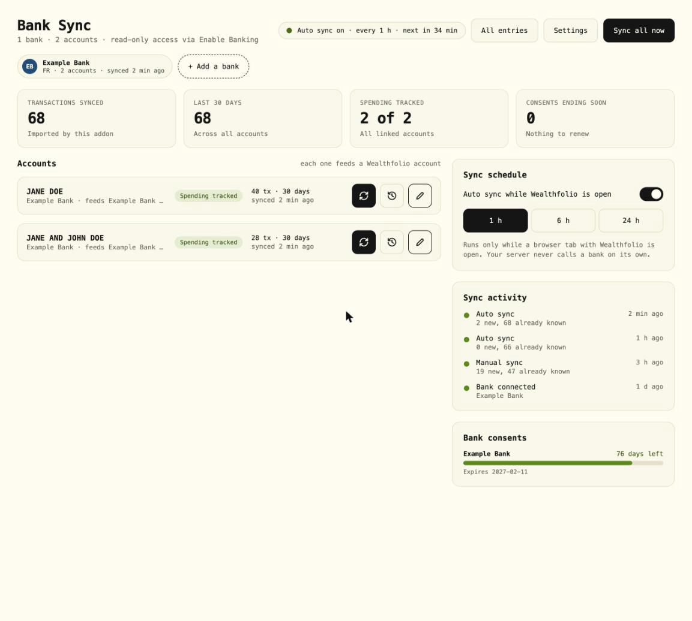

# wealthfolio-enable-banking-sync

> Import your bank transactions into [Wealthfolio](https://wealthfolio.app).

A Wealthfolio addon that connects to your banks through [Enable Banking](https://enablebanking.com) and imports what your accounts did, as plain cash activities. Wealthfolio's categories and budgets take it from there.

## What you get

- **Any bank** Enable Banking supports, several at once, across 30 European countries.
- **Safe to re-run.** Syncing twice never duplicates anything.
- **Automatic sync** while Wealthfolio is open, if you want it.
- **An entries view** that shows what each bank returned and whether it is in Wealthfolio yet, with the raw data one click away.
- **Your key stays yours.** It lives in Wealthfolio's secrets vault, and the addon only reads accounts, it cannot move money.

It only imports. Deciding what a transaction is, a transfer, groceries, salary, is left to Wealthfolio's rules or your own tooling.

## Install

You need Wealthfolio 3.13 or newer, served over HTTPS.

1. Download the zip from the [latest release](../../releases/latest).
2. In Wealthfolio, go to **Settings → Extensions**, install it from the file and approve the permissions, including the host `api.enablebanking.com`.
3. Open **Bank Sync → Settings** and enter your Enable Banking application. [This guide](docs/enable-banking.md) shows how to get one.
4. Open **Add a bank**, pick yours, authorise it and link each account.
5. In Wealthfolio's **Settings → Suivi des dépenses**, turn on tracking for the new accounts, so they count as spending.

## Good to know

- Automatic sync only runs while Wealthfolio is open in a browser tab.
- Bank consents expire after at most 90 days. The addon counts them down and renewing keeps your setup.
- How far back you get depends on your bank.

More in [Using the addon](docs/usage.md).

## Docs

- [Connecting Enable Banking](docs/enable-banking.md)
- [Using the addon](docs/usage.md)
- [Development and releases](docs/development.md)
- [Security](SECURITY.md)

## License

MIT, see [LICENSE.md](LICENSE.md).
