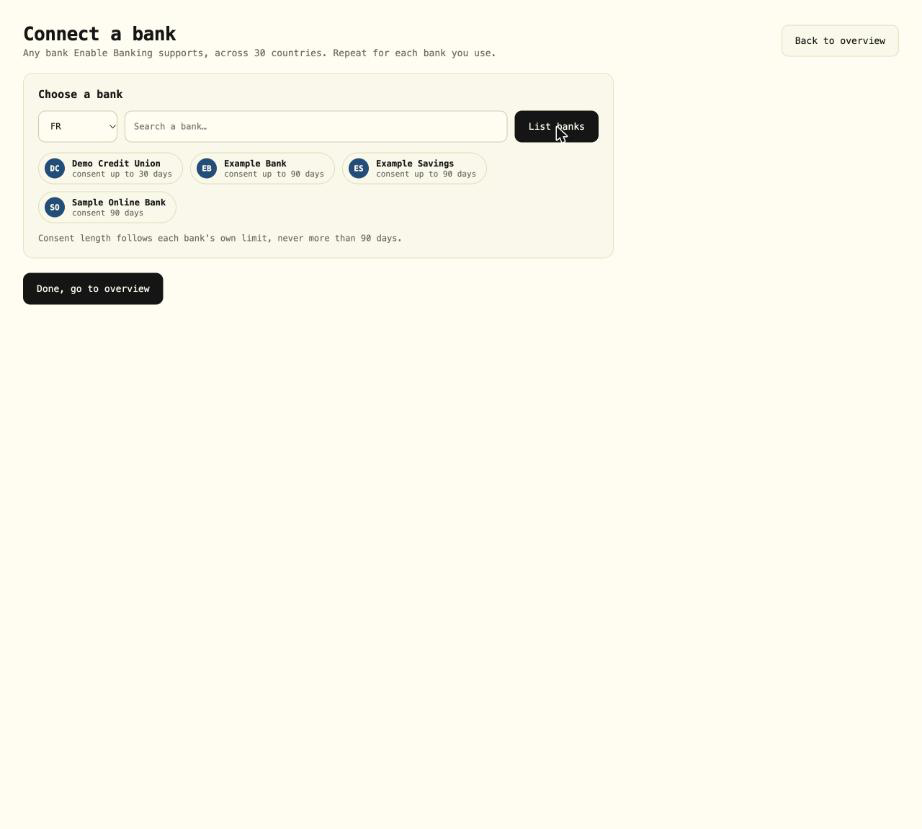
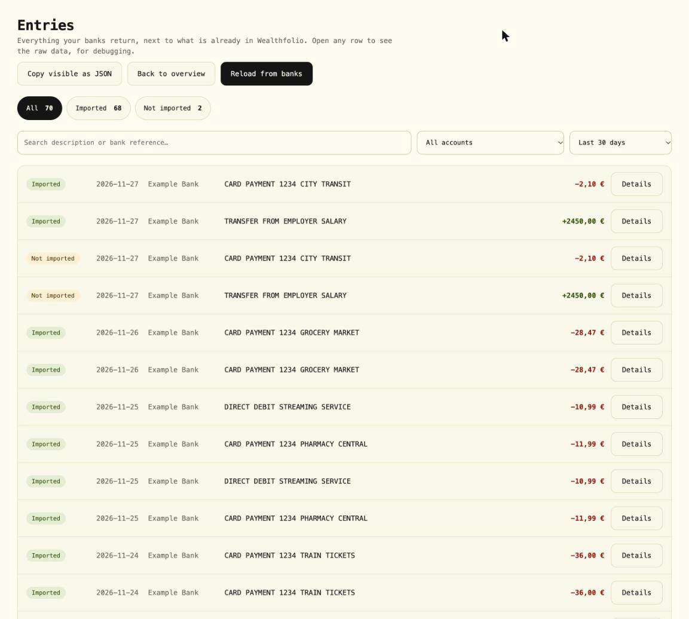
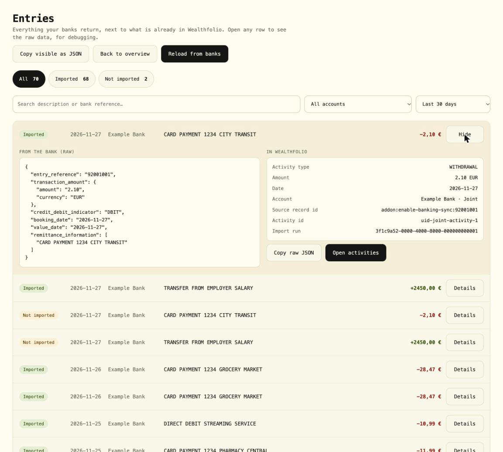
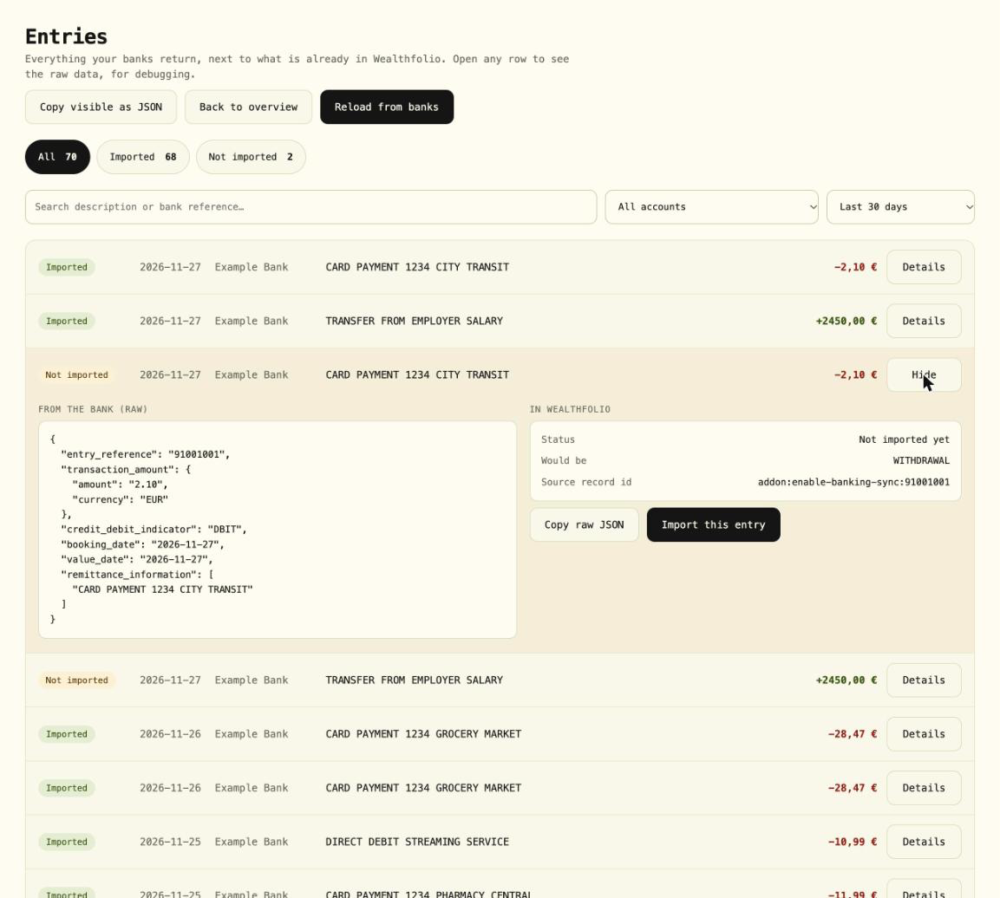
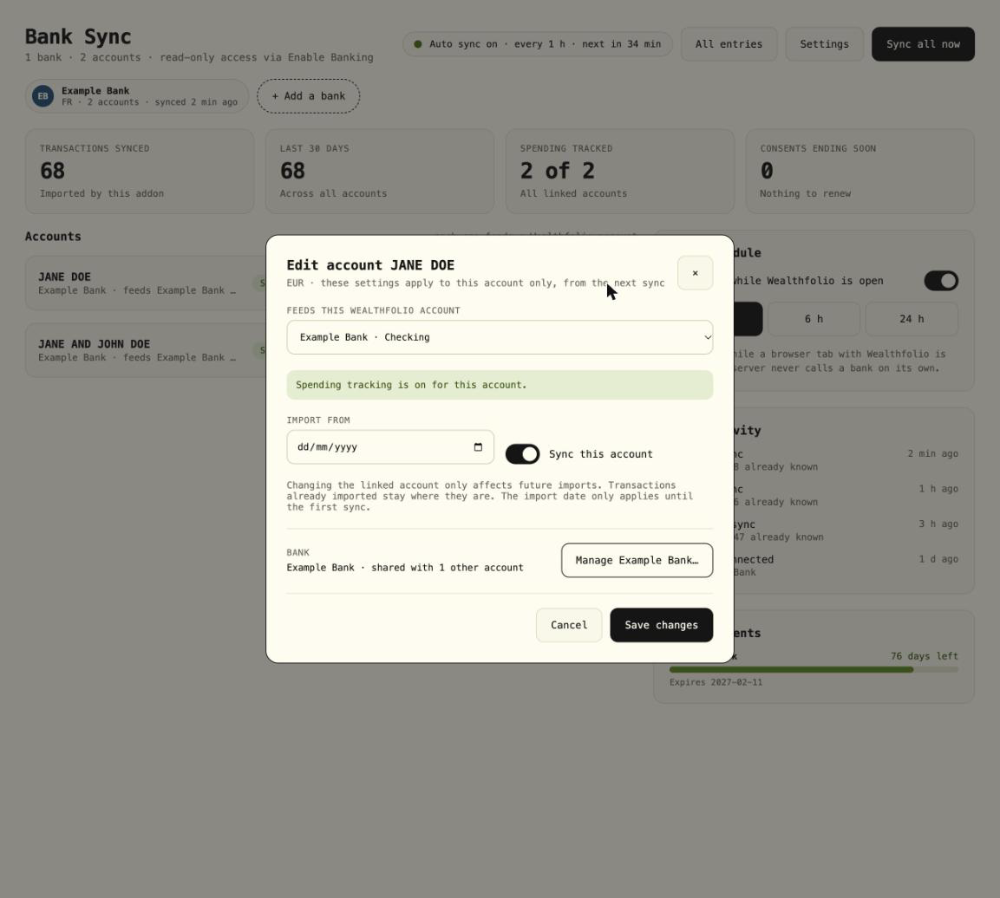
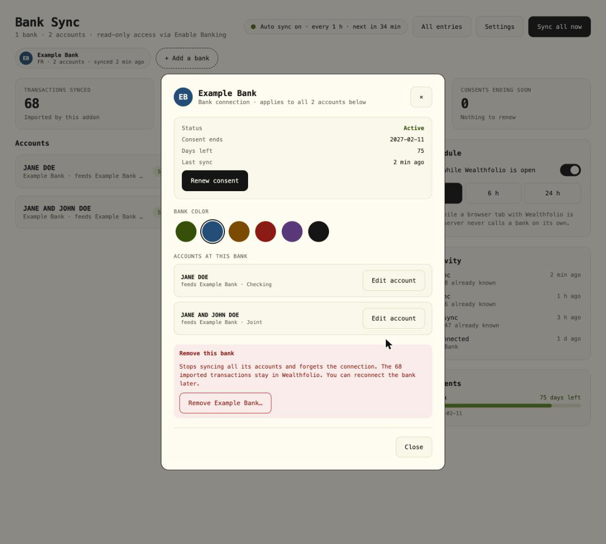
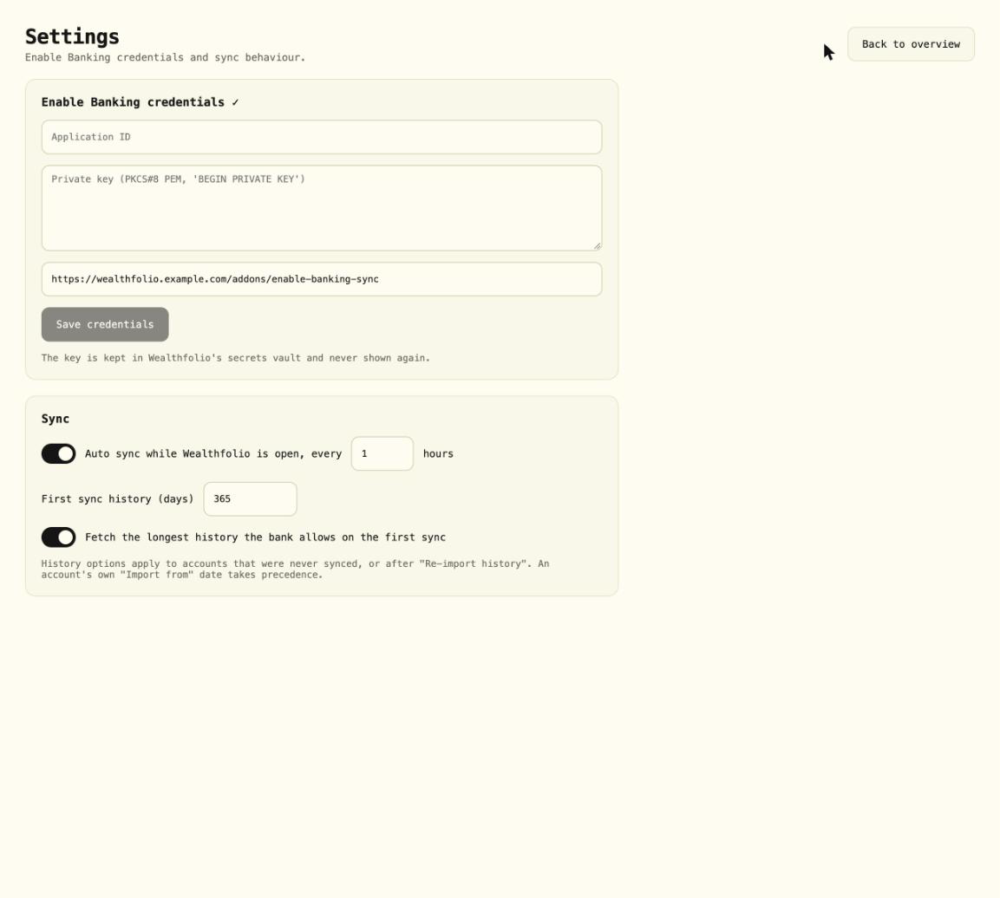

# wealthfolio-enable-banking-sync

> Your bank knows what you spent. [Wealthfolio](https://wealthfolio.app) wants to
> know. This addon carries it across — every account, every bank you give it,
> with the credentials staying on your own server.

Wealthfolio tracks investments well, and its Spending feature can follow a
budget, but it has no way to pull transactions from a bank by itself. This
addon is that missing piece. It connects to any bank [Enable
Banking](https://enablebanking.com) supports — about 2,700 across 30 European
countries — and imports what your accounts did as plain cash activities, ready
for Wealthfolio's categories and budgets.

It only **fetches and imports**. What a transaction is — a transfer between your
own accounts, groceries, salary — is for Wealthfolio's rules, or your own
tooling, to decide. Every imported activity carries the raw bank entry in its
metadata so that tooling has something to work with.

[](https://github.com/merlindorin/wealthfolio-enable-banking-sync/actions/workflows/ci.yml)
[](LICENSE.md)
[](https://wealthfolio.app)
[](.node-version)

Not affiliated with Wealthfolio or Enable Banking.


## How it works

```
   your bank                Enable Banking            Wealthfolio (your server)
  ┌─────────┐   PSD2     ┌────────────────┐      ┌──────────────────────────────┐
  │ accounts│◀──────────▶│  account info  │◀─────│  network broker (HTTPS only, │
  │  + SCA  │  consent   │      API       │ JWT  │  approved host)              │
  └─────────┘            └────────────────┘      │            ▲                 │
                                                 │  ┌─────────┴──────────┐      │
                                                 │  │  this addon        │      │
                                                 │  │  signs the JWT,    │      │
                                                 │  │  maps, dedupes     │      │
                                                 │  └─────────┬──────────┘      │
                                                 │            ▼                 │
                                                 │   cash activities in         │
                                                 │   your own accounts          │
                                                 └──────────────────────────────┘
```

You register an application with Enable Banking and get a private key. The
addon keeps that key in Wealthfolio's secrets vault, signs a one-hour token with
it, and hands the token to Wealthfolio's network broker, which is the only thing
allowed to call out. You authorise each bank once, at the bank. After that the
addon fetches booked transactions, turns each one into a deposit or a
withdrawal, and skips anything it has already imported.

A sync re-reads only the last seven days of an account it already knows, and
every entry has a stable id, so running it twice does nothing the second time.

## Contents

- [Get started](#get-started)
- [Screens](#screens)
- [How transactions are imported](#how-transactions-are-imported)
- [Settings](#settings)
- [What to know before you rely on it](#what-to-know-before-you-rely-on-it)
- [Security and privacy](#security-and-privacy)
- [Development](#development)
- [Releasing](#releasing)
- [License](#license)

## Get started

You need Wealthfolio 3.13 or newer, served over HTTPS (see
[the redirect note](docs/enable-banking.md#4-whitelist-the-redirect-url)), and
an Enable Banking application. The [Enable Banking guide](docs/enable-banking.md)
walks through the second one, step by step.

**1.** Download `wealthfolio-enable-banking-sync-addon-<version>.zip` from the
[latest release](../../releases/latest), or build it yourself:

```sh
git clone https://github.com/merlindorin/wealthfolio-enable-banking-sync && cd wealthfolio-enable-banking-sync
pnpm install && pnpm bundle      # → dist/*.zip
```

**2.** In Wealthfolio, open **Settings → Extensions**, install the zip from a
file and approve the permissions. Tick the network host `api.enablebanking.com`.

**3.** Open **Bank Sync → Settings** and save your application id, private key
and redirect URL.

**4.** Open **Bank Sync → Add a bank**, pick yours, authorise it, and link each
bank account to a Wealthfolio account.

**5.** In Wealthfolio's **Settings → Suivi des dépenses**, turn on tracking for
the accounts the addon created, so their activities show up as spending.

Then press **Sync** on an account. Turn on auto sync in the overview if you want
it to keep itself current.

## Screens

**Add a bank.** Any country Enable Banking covers, searchable. The consent
length follows each bank's own limit.



**Entries.** Everything your banks return, next to what is already in
Wealthfolio. Open a row to see the raw bank data and the Wealthfolio activity it
became, which is what to reach for when a transaction looks wrong.





A not-yet-imported entry shows what it would become and can be imported from
there.



**Edit account.** Which Wealthfolio account it feeds, where the first import
starts, and a pause switch. These apply to one account only.



**Manage bank.** What applies to the whole bank: the consent, a color, and
removal. Removing a bank keeps everything already imported.



**Settings.** Credentials and how syncing behaves.



## How transactions are imported

Each booked entry from the bank becomes one cash activity:

| Bank says | Becomes      | Why                                                   |
| --------- | ------------ | ----------------------------------------------------- |
| Debit     | `WITHDRAWAL` | Counts as spending in a Spending-tracked cash account |
| Credit    | `DEPOSIT`    | Categorizable as income                               |

The amount is always positive and the direction comes from the type. Pending
entries are not fetched, only booked ones.

Every activity carries:

- **A stable id**, the bank's `entry_reference` (else `transaction_id`, else a
  deterministic hash), stored by Wealthfolio as
  `addon:enable-banking-sync:<id>`. That is what makes a second sync a no-op.
- **A comment** made of the counterparty name when the bank gives one, and the
  remittance text.
- **The raw bank entry**, in the activity's metadata under
  `addons.enable-banking-sync.raw`, with the IBANs, bank transaction code and
  reference number lifted out when the bank provides them.

Account type matters. Use a **cash** account: on a credit-card account a
`DEPOSIT` is hidden from Spending, and a `CREDIT` activity counts as "Neutre",
neither spending nor income. The addon creates cash accounts when you ask it to.

## Settings

| Setting            | Where              | Default            | What it does                                                                               |
| ------------------ | ------------------ | ------------------ | ------------------------------------------------------------------------------------------ |
| Auto sync          | Overview, Settings | off                | Syncs every linked account on a timer, **only while Wealthfolio is open in a browser tab** |
| Interval           | Overview, Settings | 6 h                | 1, 6 or 24 hours, or any number of hours in Settings                                       |
| First sync history | Settings           | the bank's default | How many days back the first sync of an account goes                                       |
| Longest history    | Settings           | off                | Asks the bank for as far back as it allows on the first sync                               |
| Import from        | Edit account       | none               | A date for this account's first sync. Takes precedence over the two above                  |
| Sync this account  | Edit account       | on                 | Pauses one account without unlinking it                                                    |
| Bank color         | Manage bank        | by position        | The dot that marks a bank in the overview                                                  |

History options apply to accounts that were never synced, or after **Re-import
history**. Re-importing is safe: entries already in Wealthfolio are skipped.

## What to know before you rely on it

- **Auto sync is not a server job.** Wealthfolio does not run addon code on its
  server, so syncing happens only while someone has Wealthfolio open. If you
  need unattended syncing, run the import from a scheduler against Wealthfolio's
  API instead.
- **Consents expire**, at most every 90 days. The overview counts them down and
  [renewing](docs/enable-banking.md#renewing-a-consent) keeps your links.
- **New accounts are not tracked by Spending.** Wealthfolio does not let an addon
  turn that on. Until you do, activities appear under Investments. The addon
  warns you on each affected account.
- **Banks differ.** Some send no IBAN and no counterparty, only free text, so
  matching transfers between your own accounts has to work from the wording and
  amounts. Crédit Agricole is one of them.
- **How much history you get** is the bank's decision and varies a lot. Some
  banks only go back about 90 days unless you re-authenticate, others go back
  more than a year. Ask for the longest in Settings and see what comes back.
- **Tested on** a self-hosted Wealthfolio 3.13 in the browser. The desktop app
  has no public address for the bank to return to, so the redirect flow does not
  apply there.

## Security and privacy

- The private key lives only in Wealthfolio's secrets vault. The addon never
  logs it and never shows it again after you save it.
- The only host it talks to is `api.enablebanking.com`, through Wealthfolio's
  broker, and only after you approve it at install time.
- Access is read-only account information. It cannot move money.
- No telemetry, no third-party services.

See [SECURITY.md](SECURITY.md) to report a vulnerability.

## Development

You need [Node](https://nodejs.org) 24 and [pnpm](https://pnpm.io). [Task](https://taskfile.dev)
is optional; every task has a plain `pnpm` equivalent.

```sh
pnpm install
task check          # typecheck, lint, format, tests with coverage, build
task test           # just the tests
task demo           # the real UI on fictional data → http://localhost:5199
task bundle         # the installable zip → dist/
```

`task demo` renders the addon against a mocked Wealthfolio, with a made-up bank
and made-up transactions, so you can work on the interface without an Enable
Banking account. The screenshots above come from it.

The logic lives in `src/lib`, free of React and of the host, and is where the
tests are: over a hundred, with a 90% line threshold in CI. The screens are thin.
[AGENT.md](AGENT.md) maps the repository and lists the traps.

Changes follow [Conventional Commits](https://www.conventionalcommits.org/) and
tests come first.

## Releasing

```sh
task release -- minor     # or patch, major, or an explicit x.y.z
git push origin main --follow-tags
```

`task release` refuses to run on a dirty tree or off `main`, moves the
`Unreleased` notes of [CHANGELOG.md](CHANGELOG.md) under the new version, bumps
`package.json` and `manifest.json` together, runs every check, then commits and
tags `vX.Y.Z`. Pushing the tag starts the `release` workflow, which verifies the
tag against the package version, rebuilds, and publishes a GitHub release with
the zip, a `SHA256SUMS` file and the changelog section as notes.

## License

MIT, see [LICENSE.md](LICENSE.md).
